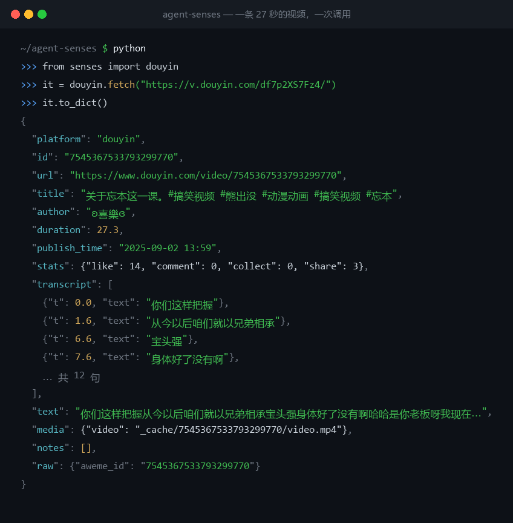

# agent-senses

**Organs for AI agents.**

Models don't lack brains — they lack eyes and hands. A human clicks a Chinese content link and reads it. An agent has to fight anti-bot checks, reverse-engineer request signing, download segmented video, and run speech-to-text — a dozen tool calls, most of them failing.

This project collapses those dozen calls into **one function call**.

```
douyin_get(url)  →  caption + author + duration + engagement + transcript + local file
ds_search(query) →  titles + URLs + snippets + long summaries + dates + authority scores
ds_fetch(url)    →  page body as Markdown
```



[中文 README](README.md)

## Why

The generic capabilities — files, shell, web search — are being built by the model vendors themselves. Nobody needs a seventh implementation.

Chinese content platforms are different:

- **Vendors won't build it.** Their users don't need it.
- **Overseas devs can't build it.** They can't reproduce the environment, the network, or the platforms.
- **It's genuinely needed.** Anyone doing research, content work, or monitoring in Chinese has this gap.

The anti-bot barrier *is* the moat.

## Install

```bash
pip install -r requirements.txt
# Uses your system Chrome via Playwright — no bundled Chromium download.
```

ffmpeg is optional; without it the tool falls back to the one bundled with `imageio-ffmpeg`.
The transcription model defaults to `small` and is looked up in the HuggingFace cache:

```bash
HF_ENDPOINT=https://hf-mirror.com huggingface-cli download Systran/faster-whisper-small
# or point SENSES_WHISPER_DIR at a model directory
```

## Use

**Standalone (debugging)**

```bash
python server.py --selftest "https://v.douyin.com/xxxx/"
```

**As an MCP server in Claude Code**

```bash
claude mcp add agent-senses --scope user -- <python-path> "<this-dir>/server.py"
# remove with: claude mcp remove agent-senses
```

**Search / fetch (DeepSeek Search & Fetch API)**

No MCP session needed — scripts, pipes and cron jobs can call it directly:

```bash
python dsweb.py search "query" --count 5 --pretty
python dsweb.py fetch "https://example.com/article" --max-chars 5000
```

`query` supports `site:` / `-site:` / `"exact phrase"` / `lang:zh,en` / `after:2025`.

Key lookup order: `DEEPSEEK_API_KEY` → `~/.claude/settings.json` → `~/.dsh/.credentials.yaml`.
Billing is per successful request (¥5 / 1000 calls at the time of writing).

**As a library**

```python
from senses import douyin
item = douyin.fetch("https://v.douyin.com/xxxx/", want_video=False)
print(item.author, item.duration)
print(item.text)
```

## Architecture

```
senses/            core library — the capability itself, independent of MCP
  models.py        the data contract agents see
  douyin.py        Douyin: resolve → capture → download → mux → transcribe
  web.py           web search / fetch (DeepSeek Search & Fetch API)
  media.py         ffmpeg wrapper
  asr.py           speech-to-text
server.py          MCP shell — thin, replaceable by CLI / HTTP
dsweb.py           CLI entry for search/fetch, for scripts without MCP
tests/             protocol-level self-tests
```

**Why the library and the shell are separate:** MCP is still changing. Keeping the capability in a
plain library means a protocol change only replaces the shell, never the body.

## Adding the next platform

Copy the shape of `douyin.py`:

1. `resolve(url)` — normalize the link, get the platform-internal id
2. `_capture(id)` — pull the page's data (**intercept the JSON API, don't scrape DOM text**)
3. `_download / merge / transcribe` — shared, import them
4. Register an `xxx_get` tool in `server.py`

Return a `Item`. The shape agents see never changes.

## Pitfalls (learned the hard way)

| Symptom | Cause | Fix |
|---|---|---|
| `Fresh cookies needed` from yt-dlp | Douyin Argus risk control | don't use yt-dlp |
| `--cookies-from-browser` fails with DPAPI error | Chromium App-Bound encryption | don't reuse browser cookies |
| Share page `_ROUTER_DATA` is empty | SSR no longer ships details | run the real page in Playwright |
| Direct `detail` API returns 403 `Uifid Not Found` | endpoint requires page context | intercept the request the page itself makes |
| Segmented download 403 | missing Referer | send `Referer: https://www.douyin.com/` |
| `av.open(metadata_errors=)` TypeError | PyAV version mismatch | feed wave+numpy directly, skip decoding |
| Model load reports incomplete snapshot | `model.bin` not fully downloaded | verify `model.bin` exists before loading |
| `cublas64_12.dll not found` | cuBLAS missing | fall back to CPU int8 |
| Transcript mixes Traditional and Simplified | Whisper's Chinese output is unconstrained | `initial_prompt` does not fix it (it made other words worse) — convert with opencc afterwards |
| DOM fallback reports someone else's author | the player auto-advances to the next video | only trust DOM fields when its caption matches the API's |
| `author` / `statistics` are empty | the detail endpoint returned a partial payload | match on `aweme_id`; degradation is reported in `notes` |

## Boundaries

- No login state, no account operations, no private content
- Public content only
- Transcription is a *shorthand*, not an edit — accents and fast speech produce errors; verify before quoting
- One platform, one item at a time. No batching, deduplication or caching yet

## License

MIT
